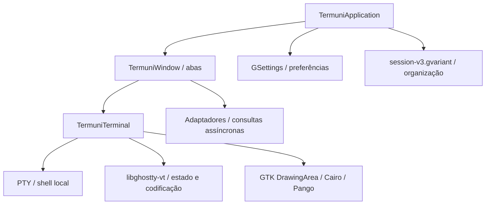

# Termuni — requisitos e arquitetura

Atualizado em 14/11/2026. O estado dos marcos e suas evidências ficam no quadro **Estado atual** de [PLANO_IMPLEMENTACAO.md](PLANO_IMPLEMENTACAO.md); consulte-o antes de continuar a implementação.

## Produto

O Termuni é primeiro um terminal nativo GNOME para Linux, com sessões em abas e suporte a aplicações TUI. Shell, PTY, entrada, seleção, colagem, Unicode/emoji e cores True Color são parte do terminal. Claude Code/Codex são integrações opcionais: sua ausência não deve comprometer o emulador. A aparência e as interações previstas estão em [DESIGN.md](DESIGN.md).

A implementação atual inclui seleção, copiar e colar, scrollback, visão geral de abas, preferências, busca com realce, anexação de imagens para Claude Code/Codex e persistência de organização. Acessibilidade do conteúdo do terminal permanece incompleta. O [roadmap](docs/ROADMAP.md) separa código ausente, correções e aceite manual; a presença de uma ação ou tela não garante sua validação.

## Decisões de produto

- Perfis de terminal ficam fora do escopo da primeira versão estável.
- Integração com agentes: Claude Code e Codex CLI são o MVP. Preferências → Anexos guarda a escolha explícita; Abrir agente cria uma aba no diretório conhecido da sessão. Os adaptadores concentram binários/formatação/comando e consultas de disponibilidade. PNG, JPEG e Ctrl+V foram validados com os dois CLIs reais no P2 sob Xvfb; demais agentes ficam fora deste aceite.
- Atalhos: Ctrl+C, Ctrl+V, Ctrl+Shift+C, Ctrl+Shift+V, Ctrl+Seta para a esquerda e Ctrl+A são ações de janela editáveis em Preferências, com os padrões de fábrica preservados e restauração em "Restaurar padrões".
- Sessão: o formato atual é `session-v3.gvariant` (com geometria da janela). A sessão `session-v2.gvariant` é convertida uma única vez, quando o v3 ainda não existe, preservando as abas e as pastas. Depois disso o v2 não é mais lido. A origem v2 não é apagada; os testes cobrem idempotência e falha de gravação sem perda da origem. Uma sessão sem janelas é um estado válido, com serialização de zero bytes.
- Notificações são opt-in (`notifications=false` por padrão). A política exige janela ou aba fora de foco e evento elegível; relatos explícitos Bash mantêm o comportamento anterior de comandos curtos, enquanto o fallback por processo aplica o limiar de tarefa longa. Entrega/clique no desktop ainda precisam de aceite.
- Créditos: `translator-credits` é reservado aos tradutores. A autoria e os créditos de desenvolvimento ficam na janela Sobre.

## Critério de estabilidade

Os [critérios da primeira versão estável](docs/checklists/stability.md) são o contrato de aceite: confiabilidade do terminal, restauração, distribuição/Builder, fluxos suportados de anexo, ausência de crescimento contínuo de memória inexplicado, acessibilidade/escalas e consistência visual/documental. O Marco 5 inteiro não é pré-requisito; busca com realce e conflitos já existem. Expansões opcionais não devem adiar correções do emulador, persistência ou distribuição.

A matriz distingue o que já foi implementado de validação pendente. TUI moderna, Unicode/emoji e True Color têm cenários explícitos; não se infere compatibilidade com toda aplicação a partir das capacidades do motor.

## Decisões técnicas

- C com GTK 4 e libadwaita; Meson como build e projeto aberto no GNOME Builder. O formato de instalação escolhido é pacote `.deb` nativo para Ubuntu; ambiente principal: Ubuntu 26.10 em Wayland.
- libghostty-vt faz parsing VT e fornece estado, células, estilos, cores e codificação de teclas. O Termuni fornece janela, PTY, entrada e desenho.
- [subprojects/ghostty.wrap](subprojects/ghostty.wrap) fixa Ghostty em `f64f4aca2c29b554d111b36c3d946a9bddd159ff`. O build exige Zig `0.16.0`; URL e SHA-256 ficam fixados em `tools/zig-toolchain.json`. A API C deve ser conferida na revisão fixada ao alterá-la. O exemplo oficial Ghostling foi a referência inicial para uso da API.
- O desenho atual usa `GtkDrawingArea`, Cairo e PangoCairo. Medições devem orientar qualquer mudança para GSK, OpenGL ou outro renderer.
- `development` usa `io.github.ThiagoAciole.Termuni.Devel`, schema e ícone próprios; `default` usa `io.github.ThiagoAciole.Termuni`. Recursos GtkBuilder mantêm o caminho `/io/github/thiagoaciole/termuni`.
- A cópia de referência `/home/thiago/Downloads/termuni.old` deriva do Ptyxis e usa `VteTerminal` e CMake. Serve como referência de estrutura e interface, com detalhes em [DESIGN.md](DESIGN.md); a sessão, entrada, renderização e recursos VTE precisam de adaptação para libghostty-vt. A cópia examinada não contém histórico Git.

- Distribuição: pacote Debian local gerado pelo perfil `default` com `tools/build-deb.py`. O pacote instala o binário, lançador, schema GSettings, serviço D-Bus, traduções e ícone no sistema; dependências são obtidas do executável com `dpkg-shlibdeps`.
- Cada sessão usa `forkpty` para executar o shell local do usuário. O PTY fornece o controle de tarefas, Ctrl+C, resize e grupos de processos usados pela confirmação de fechamento. Bash recebe integração opt-in por rc gerado; outros shells conservam a inicialização normal e podem informar CWD com OSC 7.
- Claude Code e Codex são processos locais opcionais. Disponibilidade e inicialização usam o PATH interativo, o CWD da aba e um processo auxiliar isolado; falha/ausência do CLI não bloqueia o terminal.

## Código existente

| Local | Responsabilidade atual |
| --- | --- |
| [src/main.c](src/main.c) | Inicializa tradução e aplicação com o ID gerado pelo Meson. |
| [src/termuni-application.c](src/termuni-application.c) | Ciclo da aplicação, ações globais, preferências, paletas e GSettings. |
| [src/termuni-agent.c](src/termuni-agent.c) | Registro de agentes, citação de anexo, comando inicial e consultas assíncronas no contexto real do shell/pasta. |
| [src/termuni-window.c](src/termuni-window.c) e [src/termuni-window.ui](src/termuni-window.ui) | Janela, cabeçalho, menu, abas, overview e ações de janela. |
| [src/termuni-terminal.c](src/termuni-terminal.c) | Widget, PTY e shell, I/O GLib, estado Ghostty, renderer Cairo/Pango e entrada/IME. As camadas de sessão e renderer ainda não são módulos separados. |
| [src/termuni-vt.c](src/termuni-vt.c) | Seleção, paste e busca/geometria sobre a API fixada, sem dependência de GTK. Consultas à grade preservam dirty flags do renderizador. |
| [src/termuni-settings.c](src/termuni-settings.c) | Schema instalado com fallback de desenvolvimento. |
| [src/termuni-util.c](src/termuni-util.c) e [src/termuni-attachments.c](src/termuni-attachments.c) | Helpers de paths/shell/imagens/política e armazenamento/pruning de anexos. |
| [src/termuni.css](src/termuni.css) e [src/termuni.gresource.xml](src/termuni.gresource.xml) | Estilos e recursos incorporados. |
| [data/meson.build](data/meson.build) e [data/icons/meson.build](data/icons/meson.build) | Arquivos desktop, schema, serviço, metadados e ícones por perfil. |
| [subprojects/packagefiles/ghostty/meson.build](subprojects/packagefiles/ghostty/meson.build) | Integração Meson do build estático da biblioteca via Zig. |
| [tools/build-deb.py](tools/build-deb.py) | Gera o pacote Debian de produção a partir do perfil `default`. |



## Fluxo de uma sessão

Cada `TermuniTerminal` cria um shell via `forkpty`, integra o descritor não bloqueante ao main loop da GLib e alimenta libghostty-vt com a saída. A fila envia entrada e respostas VT ao PTY. O render state é lido no desenho GTK; redimensionamento atualiza a grade e o PTY. O evento de título atualiza a aba e o cabeçalho. O código limita trabalho por iteração, mantém fila ativa de 1 MiB e backlog ordenado de até 256 MiB; exceder o backlog rejeita a entrada com warning. O render state persistente deve ser atualizado apenas pelo caminho de desenho: atualizações temporárias consomem dirty flags e podem esconder saída pendente. A busca usa leitura não mutante da grade. A robustez de carga e feedback de pressão têm itens específicos no roadmap.

## Build e execução locais

Zig `0.16.0`, Meson, compilador C, GTK 4, libadwaita, PangoCairo e dependências do Ghostty são necessários. Com Zig disponível no `PATH`:

```sh
meson setup build -Dprofile=development  # somente se build/ ainda não existir
meson compile -C build
./build/src/termuni
```

Use o Zig 0.16.0 disponível no PATH e confira `zig version`; caminhos antigos em `/tmp` não são instruções de build atuais. Para o perfil normal, configure um diretório separado com `-Dprofile=default`. O Builder configura o projeto Meson nativo com `development`; a execução pela interface da IDE continua pendente. Comandos e procedimentos completos em [docs/development.md](docs/development.md).

## Riscos e pontos de atenção

- O schema é procurado primeiro na fonte instalada do GLib; `BUILD_SCHEMA_DIR` é apenas fallback de desenvolvimento. Ausência de schema mantém defaults e desabilita Preferências, sem chamadas GSettings com NULL. O smoke de instalação sem build passou no P1.
- O perfil `default` foi empacotado e instalado via `.deb` local em 14/11/2026. A execução pela interface do GNOME Builder continua manual.
- O encerramento em `dispose` espera SIGHUP em loop síncrono de até 1 s (`g_usleep`/`waitpid WNOHANG`) antes de SIGKILL e espera final. M03 do roadmap propõe ownership/encerramento assíncrono. A fila ativa de 1 MiB já tem backlog de 256 MiB (P0); feedback e política de excesso são M10, não uma implementação ainda ausente de colagem grande.
- `TERM` é definido como `xterm-256color`; as capacidades anunciadas precisam ser confrontadas com o comportamento realmente implementado.
- Entrada composta, teclas, TUI, seleção, colagem, scrollback, Unicode complexo e desempenho exigem verificações específicas. A API e o desenho por célula não provam compatibilidade completa.
- As preferências cobrem Geral, Aparência, Atalhos e Anexos. A comparação das capturas Xvfb foi registrada no P3; aprovação visual no GNOME real continua pendente. Janelas e abas entram em Geral quando tiverem opções.
- Código e cenários de correção ainda abertos ficam em [docs/ROADMAP.md](docs/ROADMAP.md); a arquitetura não deve manter uma lista concorrente de pendências.
