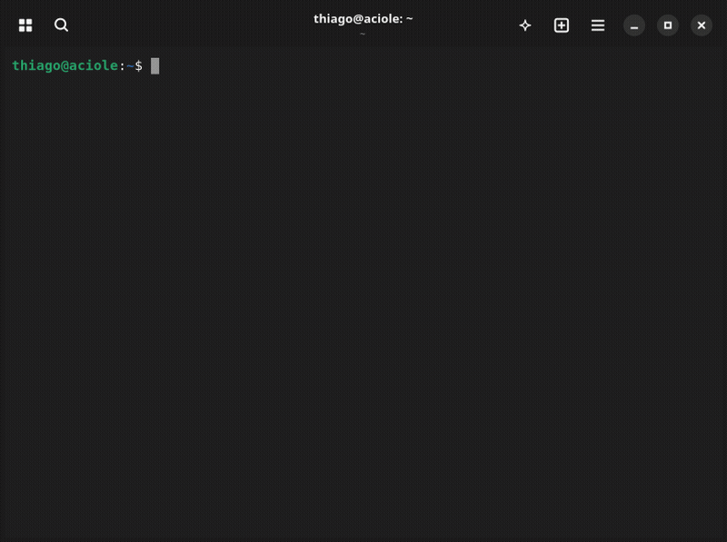
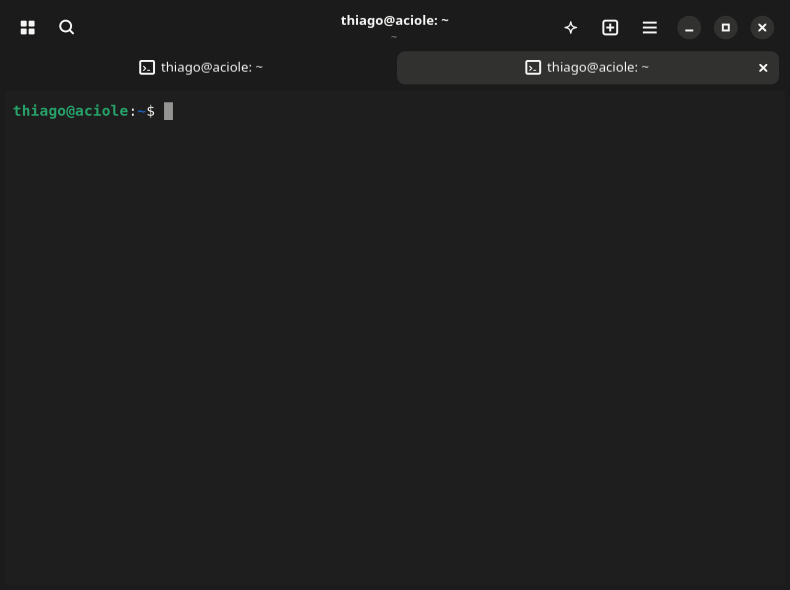
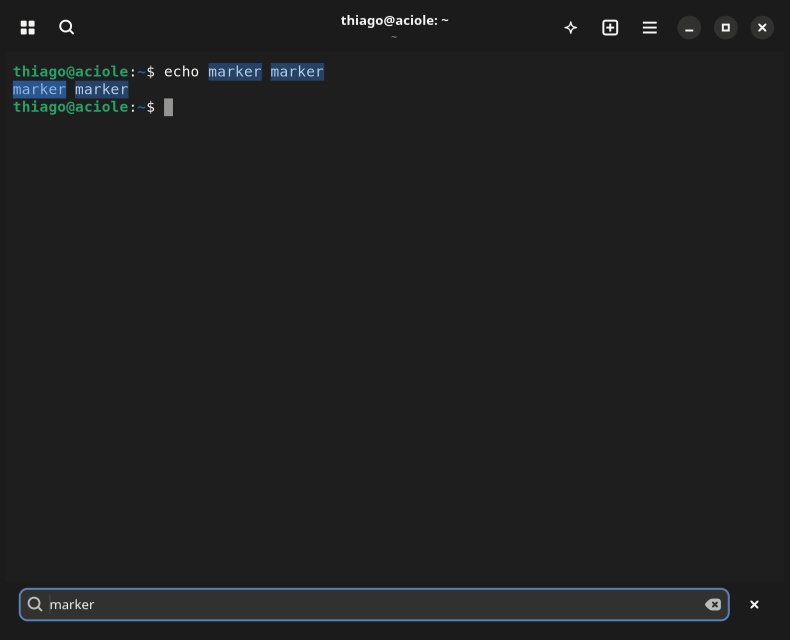

<p align="center">
  
</p>

<h1 align="center">Termuni</h1>

<p align="center">
  Um terminal nativo para GNOME, com sessões independentes e ferramentas para o seu fluxo de trabalho.
</p>

<p align="center">
  <a href="https://github.com/ThiagoAciole/Termuni/releases"></a>
  <a href="https://github.com/ThiagoAciole/Termuni/actions/workflows/ci.yml"></a>
  <a href="COPYING"></a>
</p>

<p align="center">
  <a href="https://github.com/ThiagoAciole/Termuni/releases">Pacotes e releases</a> ·
  <a href="#recursos">Recursos</a> ·
  <a href="#desenvolvimento">Desenvolvimento</a>
</p>



O Termuni é um terminal GTK 4/libadwaita para GNOME. Cada aba mantém sua própria sessão de shell, com busca no histórico, restauração de sessões e integração opcional com Claude Code e Codex CLI.

> **Estado do produto:** em desenvolvimento ativo. Os pacotes e releases serão publicados automaticamente pelo GitHub Actions quando uma tag de versão for enviada. A validação final em GNOME/Wayland segue em andamento; veja o [estado atual](docs/PLANO_IMPLEMENTACAO.md).

## Recursos

- **Sessões em abas:** cada aba tem seu próprio shell, diretório de trabalho e estado de sessão.
- **Busca no terminal:** encontre texto no histórico com realce e navegação entre resultados.
- **Fluxo GNOME:** interface GTK 4/libadwaita, overview de abas, atalhos, temas e fontes configuráveis.
- **Anexos para agentes:** envie imagens do clipboard ou arquivos para Claude Code e Codex CLI instalados localmente.
- **Shell local:** PTY e processos executam como o usuário, sem sandbox ou serviço remoto.
- **Código aberto:** C, Meson e `libghostty-vt`, sob GNU GPL v3 ou posterior.

## Capturas

<p align="center">
  
</p>

<p align="center"><em>Duas sessões independentes, lado a lado na faixa de abas.</em></p>

<p align="center">
  
</p>

<p align="center"><em>A busca realça as ocorrências no conteúdo do terminal.</em></p>

As imagens são capturas do aplicativo sob Xvfb; a aparência pode variar com o tema e a versão do GNOME.

## Instalação

Baixe o pacote `.deb` mais recente em [Releases](https://github.com/ThiagoAciole/Termuni/releases) e instale no Ubuntu 26.04 ou em uma distribuição Debian compatível com GTK 4.22 e libadwaita 1.8:

```sh
sudo apt install ./io.github.thiagoaciole.termuni_VERSION_amd64.deb
```

O pacote é gerado e anexado automaticamente ao GitHub Release ao publicar uma tag `vX.Y.Z` que corresponda à versão do projeto. Para gerar um `.deb` localmente:

```sh
python3 tools/build-deb.py
```

O arquivo será salvo em `build/packages/`. O script requer Meson, Ninja, Zig 0.16.0 e as dependências de desenvolvimento listadas em [`docs/development.md`](docs/development.md).

## Desenvolvimento

### Requisitos

Linux, compilador C, Meson, Ninja, pkg-config, GTK **4.22+**, libadwaita **1.8+**, GLib/GIO, PangoCairo e Zig **0.16.0**. O primeiro build baixa a revisão fixada de `libghostty-vt` e requer acesso à rede.

### Compilar e executar

```sh
meson setup build/development -Dprofile=development
meson compile -C build/development
build/development/src/termuni
```

O perfil `development` tem identidade própria (`io.github.ThiagoAciole.Termuni.Devel`). Para compilar o perfil de uso normal sem empacotar:

```sh
meson setup build/default -Dprofile=default
meson compile -C build/default
```

### Testes

```sh
meson test -C build/development --print-errorlogs
```

A suíte inclui testes GTK em Xvfb e HiDPI. Testes de contas e CLIs reais são opt-in. Build e testes automatizados não substituem a validação manual no GNOME Builder, Wayland, IME, acessibilidade e notificações.

## Documentação

- [Estado atual e próximos aceites](docs/PLANO_IMPLEMENTACAO.md)
- [Roadmap do produto](docs/ROADMAP.md)
- [Arquitetura e decisões](docs/architecture/PDR.Arquiteture.md)
- [Design e referências](docs/design/DESIGN.md)
- [Build, testes e empacotamento](docs/development.md)
- [Índice da documentação](docs/README.md)

## Licença

Termuni é distribuído sob a [GNU GPL v3 ou posterior](COPYING).
